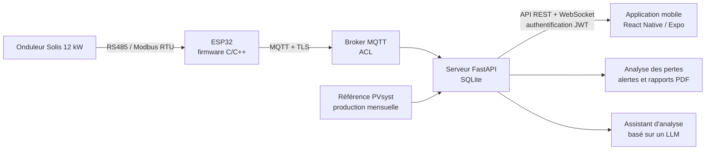

# Sphere Solar

Supervision IoT d'une installation photovoltaïque raccordée au réseau, de l'onduleur jusqu'à l'application mobile, avec détection automatique des pertes de production.

Projet de fin d'études d'ingénieur (ENIG, génie électrique et automatique), réalisé à la STEG Metlaoui en 2026.

| Installation | Valeur |
|---|---|
| Puissance crête | 10,8 kWc |
| Modules | 18 |
| Onduleur | Solis 12 kW |
| Ratio de performance simulé (PVsyst) | 88 % |

<!-- Ajoute ici 2 ou 3 captures de l'application, par exemple :

-->

## Le problème

Une installation photovoltaïque peut perdre de la production lentement, par exemple à cause de l'encrassement des panneaux, sans qu'aucune panne ne soit signalée. Sans comparaison avec une production de référence, ces pertes passent inaperçues pendant des semaines.

Sphere Solar compare chaque jour la production mesurée à la production de référence calculée avec PVsyst, mois par mois, et alerte l'exploitant quand l'écart devient anormal.

## Architecture



## Fonctionnalités

- Lecture des données de l'onduleur en RS485 / Modbus RTU par un ESP32.
- Transmission des mesures en MQTT, avec un broker sécurisé par TLS et listes de contrôle d'accès.
- Stockage et exposition des données par un serveur FastAPI : API REST, flux temps réel en WebSocket, authentification JWT.
- Application mobile pour suivre la production en temps réel et l'historique.
- Détection des pertes lentes par comparaison quotidienne avec la référence PVsyst.
- Alertes, génération de rapports PDF et assistant d'analyse basé sur un LLM.

## Structure du dépôt

```
sphere-solar/
├── src/              # Firmware ESP32 (C/C++) : lecture Modbus RTU et publication MQTT
├── include/          # En-têtes du firmware
├── test/             # Tests du firmware
├── platformio.ini    # Configuration PlatformIO
├── diagram.json      # Circuit de simulation Wokwi
├── wokwi.toml        # Configuration Wokwi
├── backend/          # FastAPI + SQLite : API REST, WebSocket, JWT, analyse des pertes
├── mobile/           # Application React Native / Expo
├── scripts/          # Scripts utilitaires
└── start.bat / start.sh   # Lancement rapide sous Windows ou Linux
```

## Lancer le projet

### Prérequis

- Python 3.10 ou plus récent
- Node.js et Expo
- Un broker MQTT (Mosquitto par exemple)
- Pour le firmware : VS Code avec l'extension PlatformIO

### Configuration

Les secrets ne sont pas dans le dépôt. Les fichiers d'exemple listent tout ce qu'il faut configurer :

- `backend/.env.example` : clé JWT, compte administrateur, broker MQTT et clé de l'assistant LLM. Définis ces variables d'environnement avant de lancer le serveur.
- `mobile/.env.example` : à copier en `mobile/.env` puis à remplir.

```bash
cp mobile/.env.example mobile/.env
```

Sous Windows, `setup.bat` puis `start.bat` installent et lancent l'ensemble ; voir aussi `WINDOWS_SETUP.md`.

### Serveur

```bash
cd backend
python -m venv .venv
pip install -r requirements.txt
python run.py
```

### Application mobile

```bash
cd mobile
npm install
npx expo start
```

### Firmware

Ouvre le dossier du projet dans VS Code avec PlatformIO, renseigne les paramètres Wi-Fi et du broker, puis compile et téléverse sur l'ESP32 :

```bash
pio run -t upload
```

Pour la simulation, lance Wokwi depuis VS Code : le circuit est décrit dans `diagram.json`.

## Démonstration en simulation

La chaîne a été validée de bout en bout en simulation avec Wokwi, sans matériel.

<!-- Lien de la simulation : https://wokwi.com/projects/... -->

## État du projet

- Chaîne complète validée en simulation.
- Configuration sécurisée du broker (TLS, ACL) prête pour le déploiement.
- Prochaine étape : raccordement à l'onduleur réel.

## Technologies

ESP32 · C/C++ · RS485 / Modbus RTU · MQTT · Python · FastAPI · SQLite · WebSocket · JWT · React Native · Expo · PVsyst

## Auteur

**Amine Mabrouki**, ingénieur en génie électrique et automatique

- LinkedIn : [linkedin.com/in/amine-mabrouki-29137921a](https://www.linkedin.com/in/amine-mabrouki-29137921a)
- E-mail : aminemabrouki113@gmail.com

## Remerciements

Merci à la STEG Metlaoui et à mes encadrants pour leur accueil et leur accompagnement pendant ce projet.
